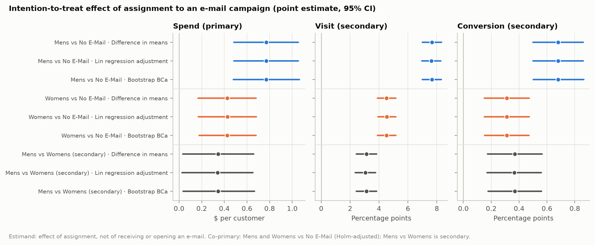
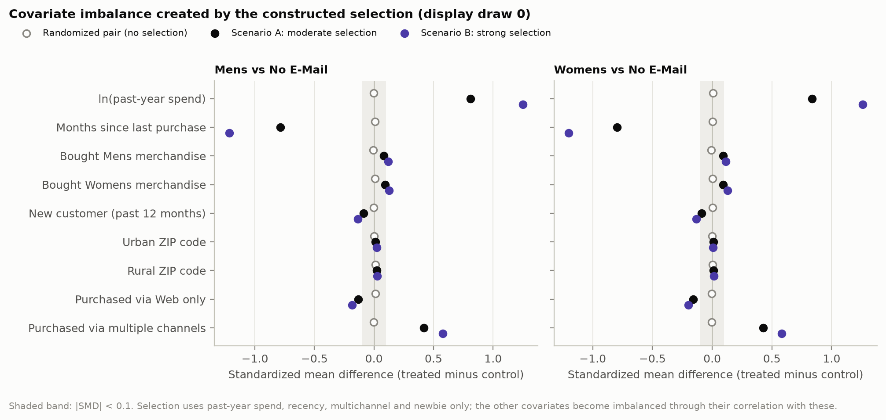
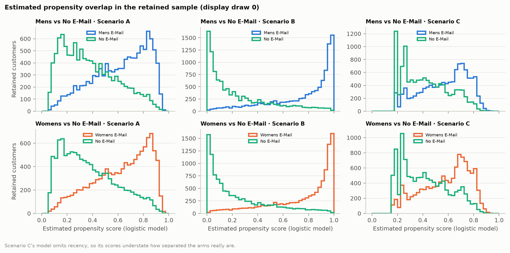
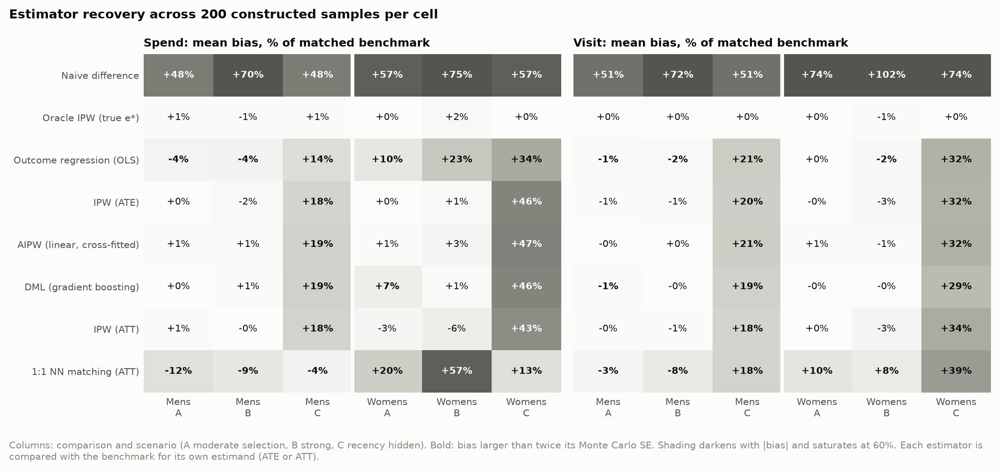
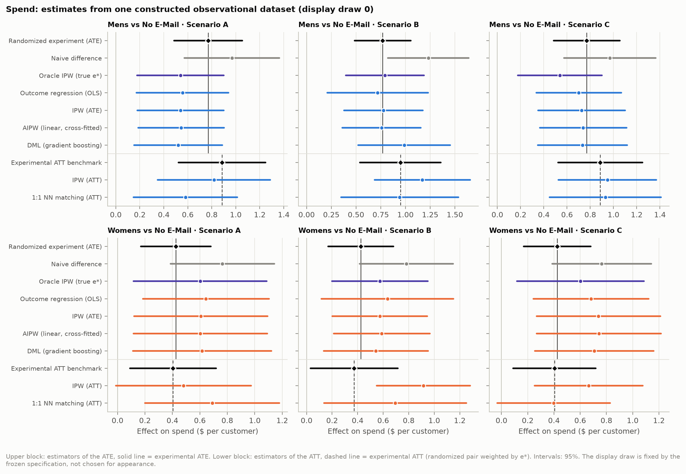
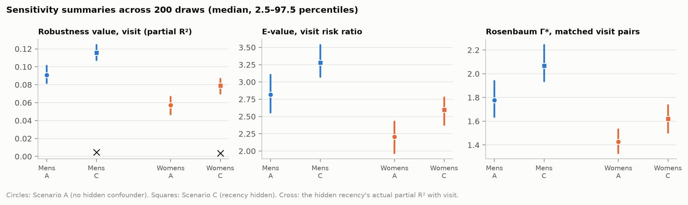
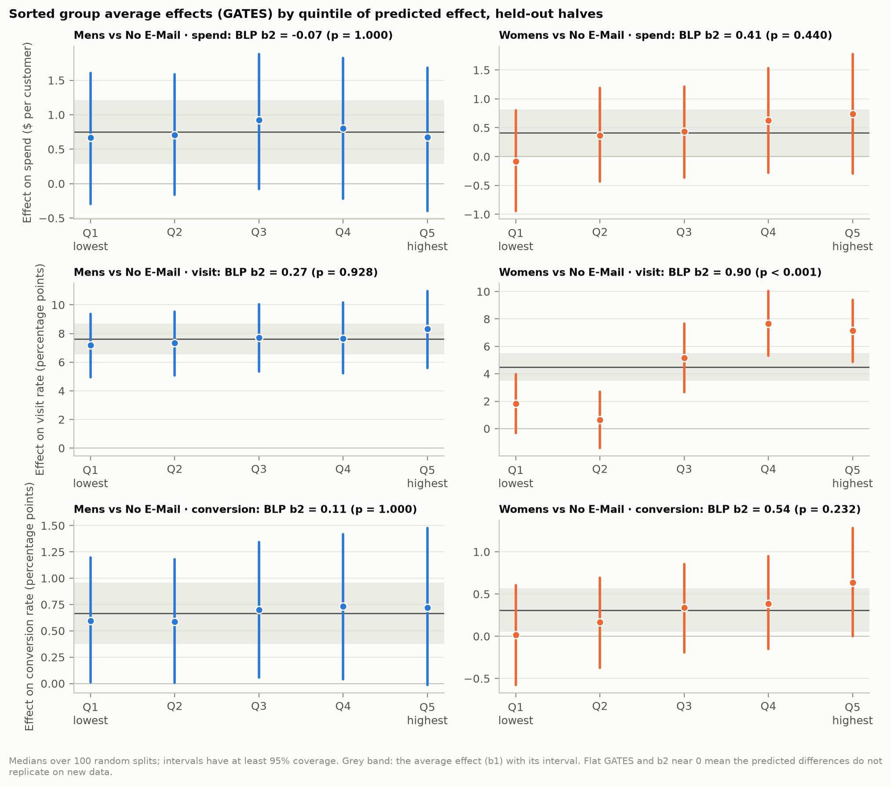
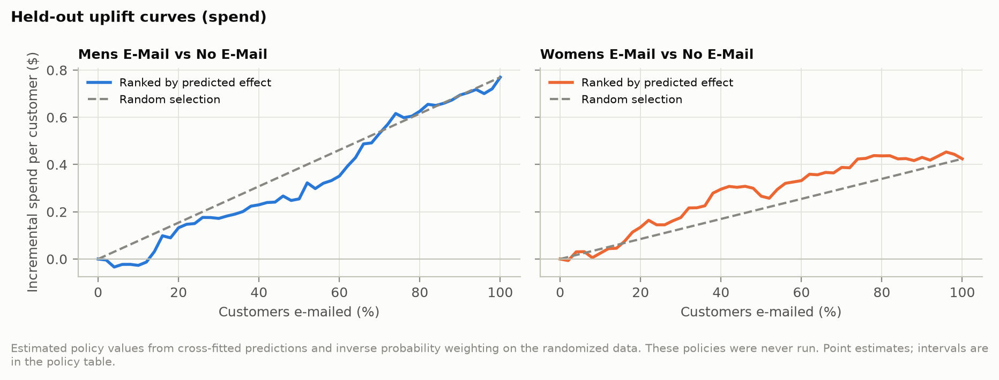

# Causeway: From Correlation to Causal Evidence

Causeway asks whether assigning customers to a promotional e-mail *caused* them to spend more. It uses
the randomized MineThatData e-mail experiment (Hillstrom, 2008).

- **Part I** analyses the randomized experiment. Its estimand is the intention-to-treat effect of
  assignment to each e-mail campaign: Mens vs No E-Mail and Womens vs No E-Mail, as co-primary contrasts.
- **Part II** deliberately breaks randomization in a documented, reproducible way. It then measures how
  well common observational estimators recover the matching experimental benchmark, first under observed
  confounding and then with a hidden confounder.

The full results, with every estimator, scenario, assumption and figure, are in the
[findings report](docs/findings.md). The verified dataset description, the pre-specified design and every
review decision are in [`docs/design.md`](docs/design.md). The observational benchmark was frozen in
[`configs/benchmark/v1.toml`](configs/benchmark/v1.toml) before any benchmark estimate was computed.

## Results at a glance

- Assignment to the **Mens e-mail** raised two-week spend by **$0.77 per customer** (95% CI $0.49 to
  $1.05), a 118% lift over the $0.65 spent by customers who received no e-mail. The **Womens e-mail** raised
  it by **$0.42** ($0.17 to $0.68). Both survive multiplicity adjustment and a randomization test.
- Once randomization is removed, comparing e-mailed with non-e-mailed customers **overstates the effect
  by about half** (+48% and +57% in the moderate-selection scenario).
- When every confounder is observed, inverse probability weighting and cross-fitted AIPW recover the
  experimental answer to within Monte Carlo error. Linear outcome regression and 1:1 caliper matching do
  not.
- When one confounder is hidden, **every estimator stays biased**: weighting, regression, AIPW and DML by
  14% to 47% on spend. Refutation tests still pass, and standard sensitivity summaries make the estimates
  look *more* robust, not less.
- Only one of six pre-specified heterogeneity tests detects variation in the effect, and model-based
  targeting does not beat e-mailing everyone with the Mens e-mail.

## The question

Does a promotional e-mail make customers spend more, or are the customers who receive promotions simply
the ones who would have bought anyway? In observational marketing data the two are entangled: companies
send promotions to their best customers, so a comparison of who got an e-mail and who spent measures that
targeting rule as much as the e-mail.

The causal quantity is the average effect of assignment, E[Y(1) − Y(0)], for spend (primary), visits and
conversions (secondary). The effect on the customers actually treated (ATT) and the variation of the effect
with customer characteristics (CATE) are studied as well.

## Dataset and experimental design

The MineThatData file covers 64,000 customers who purchased within the prior twelve months. They were
randomly assigned in thirds to a Mens e-mail, a Womens e-mail or no e-mail, and their visits, conversions
and spend were recorded for two weeks after the campaign. Pre-treatment covariates are past-year spend,
months since last purchase, merchandise categories bought, new-customer status, ZIP-code type and purchase
channel. There are no missing values. All 64,000 rows are kept, including 6,562 exact duplicate rows: with
coarse covariates and mostly zero outcomes, identical rows are expected and are not evidence of duplicated
records ([design, Section 1](docs/design.md)).

Because assignment was randomized, the experiment identifies the effect of *assignment* to an e-mail. It
does not identify the effect of receiving or opening one; neither was recorded.

## Research design

1. **Part I** estimates the intention-to-treat effects from the experiment with design-based methods.
2. **Part II** subsamples each randomized pair with a known selection rule, so that treatment depends on
   customer history as it would in observational data. The full randomized pair still supplies the true
   answer, so each observational estimator can be scored against it.
3. **Heterogeneity, targeting, robustness and sensitivity** analyses are pre-specified in
   [`configs/`](configs) and were committed before their results.

Every Part II estimate is compared with the experimental benchmark for its own estimand: ATE estimators
with the ATE, ATT estimators with the ATT. An ATT is never treated as an ATE.

## Part I: the randomized experiment

| Contrast | Outcome | Effect | 95% CI | Holm p | Randomization p |
|---|---|---|---|---|---|
| Mens vs No E-Mail | spend | $0.77 | [$0.49, $1.05] | < 0.0001 | ≤ 0.0001 |
| Womens vs No E-Mail | spend | $0.42 | [$0.17, $0.68] | 0.0011 | 0.0010 |
| Mens vs No E-Mail | visit | 7.66 pp | [7.00, 8.32] | < 0.0001 | ≤ 0.0001 |
| Womens vs No E-Mail | visit | 4.52 pp | [3.89, 5.16] | < 0.0001 | ≤ 0.0001 |
| Mens vs No E-Mail | conversion | 0.68 pp | [0.50, 0.86] | < 0.0001 | ≤ 0.0001 |
| Womens vs No E-Mail | conversion | 0.31 pp | [0.15, 0.47] | 0.0002 | 0.0003 |

Effects are differences in means; pp means percentage points. The Mens e-mail also beat the Womens e-mail
on spend by $0.35 ($0.03 to $0.66; secondary contrast, randomization p = 0.029).



The randomization holds up: no covariate differs between arms by more than 0.014 standard deviations, and
a classifier cannot tell the arms apart (out-of-fold AUC 0.498 and 0.494). The spend effect is stable under
the pre-specified alternatives: recoding the $499 values or winsorizing moves the Mens estimate only
between $0.74 and $0.77, and keeping one copy of each duplicate row gives $0.85. The data hold an observed
maximum of $499; whether it reflects a true maximum or a data-generation constraint is unknown.

## Part II: a constructed observational benchmark

### How selection was introduced

Customers are kept from each randomized pair by rejection sampling (Keith et al., 2023), with an
assignment probability that rises with past-year spend and multichannel buying and falls with months
since purchase and new-customer status. Three scenarios, each with 200 independent draws:

- **A:** moderate selection on covariates the analyst observes.
- **B:** twice as strong, which stresses overlap and produces extreme weights.
- **C:** the strength of A, but recency is hidden from the analyst, so unconfoundedness fails.

The construction is checked before use: a weighting estimator that knows the true selection probability
(an oracle, not a feasible estimator) recovers the benchmark in every cell.





### Observational estimators

The naive difference in means; inverse probability weighting for the ATE and the ATT; 1:1 nearest-neighbour
propensity matching with a 0.2-SD caliper; outcome regression; cross-fitted AIPW (hand-written and checked
against EconML); and Double Machine Learning with gradient boosting (DoubleML, checked against a
hand-written orthogonal score).

### Estimator recovery



Mean bias of the spend estimate over 200 draws, as a percentage of each estimator's own benchmark (bold in
the figure: larger than twice its Monte Carlo standard error):

| Spend | Mens A | Mens B | Mens C | Womens A | Womens B | Womens C |
|---|---|---|---|---|---|---|
| Naive difference | +48% | +70% | +48% | +57% | +75% | +57% |
| Outcome regression (OLS) | −4% | −4% | +14% | +10% | +23% | +34% |
| IPW (ATE) | +0% | −2% | +18% | +0% | +2% | +46% |
| AIPW (cross-fitted) | +1% | +1% | +19% | +1% | +3% | +47% |
| DML (gradient boosting) | +0% | +1% | +19% | +7% | +1% | +46% |
| IPW (ATT) | +1% | −0% | +18% | −3% | −6% | +43% |
| 1:1 matching (ATT) | −12% | −9% | −4% | +20% | +57% | +13% |

- With every confounder observed (A and B), weighting and AIPW are unbiased within Monte Carlo error for
  both comparisons, and so is DML in Scenario B. Each cell is a separate test at about the 5% level, so the
  single DML flag (Womens, Scenario A) is weak evidence on its own.
- Linear outcome regression is biased in most cells: with unconfoundedness holding, that can only come
  from its misspecified outcome model. A boosted outcome model used on its own does worse (+18% and +26%
  in Scenario A), yet AIPW with the same boosted models stays unbiased. That is what the orthogonal score
  and cross-fitting are for.
- Caliper matching is biased in every cell. The 0.2-SD caliper discards 37% to 60% of treated customers
  who have no close control, which changes who the estimate describes, and no caliper width fixes both
  comparisons.



### Hidden confounding

With recency hidden (Scenario C), no adjustment removes the bias, because no estimator can adjust for a
variable it does not see. On visits, weighting, regression, AIPW and DML are biased by 18% to 34%. The
diagnostics an analyst would normally run do not reveal this:

- **Refutation tests pass.** A placebo treatment is rejected in at most 6% of draws, and a random added
  covariate or an 80% subsample barely moves the estimate, exactly as in Scenario A.
- **Sensitivity summaries look better, not worse.** The robustness value for visit rises from 0.091 to
  0.116 (Mens) and from 0.057 to 0.079 (Womens) when the confounder is hidden; E-values and Rosenbaum Γ
  rise as well. Omitted-variable bounds for a confounder as strong as the observed covariate giving the
  largest bound cover the true error in about one draw in five; at twice that strength, about nine in ten.



### Statistical versus identification uncertainty

Confidence intervals measure sampling variability under the stated assumptions; they say nothing about
whether the assumptions hold. In Part I randomization secures identification, so the intervals are the
whole uncertainty. In Scenario C the cross-fitted AIPW interval for the visit effect covers the truth in
only 8% and 12% of draws, against 97% and 98% for the oracle. For spend the same biased intervals still
cover in 97% and 95% of draws, but only because spend is noisy enough to make them wide. High coverage
is not evidence of small bias.

## Heterogeneous effects and decision analysis

Heterogeneity is claimed only when a pre-specified test (the best-linear-predictor slope, or the spread of
sorted group effects, over 100 sample splits) supports it. Of the six contrast-outcome pairs, only the
Womens e-mail's effect on visits varies detectably (slope 0.90, split-adjusted p < 0.0001). Elsewhere the
causal forest's predicted differences do not replicate on held-out data.



Sending each customer the e-mail the model predicts is best changes expected spend by −$0.08 per customer
compared with sending everyone the Mens e-mail (95% CI −$0.25 to $0.10). The experiment therefore supports
the simple policy. These are estimated values of policies that were never run. Their intervals hold the
fitted predictions fixed, so a fuller account of uncertainty would only strengthen this conclusion.



## Robustness and sensitivity

- **Part I:** five spend definitions (including log spend), the duplicate-free sample and five further
  bootstrap seeds all give the same conclusions.
- **Part II, specification:** a categorical propensity model leaves weighting and AIPW unbiased. A boosted
  propensity fitted in-sample biases IPW by 8% to 21% for Womens, while cross-fitted AIPW with the same
  model stays unbiased.
- **Part II, overlap:** trimming cuts error sharply under strong selection (Womens RMSE from 123% to 41%
  of the trimmed benchmark) at the cost of a narrower population; caliper width cannot rescue matching.
- **Hidden confounding:** see above. Refutation tests check estimator behaviour, not the absence of a
  confounder.

## What we can conclude

- Assignment to either e-mail increased two-week spend, visits and conversions among these customers, and
  the Mens e-mail outperformed the Womens e-mail on all three.
- When selection depends only on recorded covariates and overlap holds, weighting and doubly robust
  estimators recover the experimental effect; misspecified outcome regression and caliper matching do not.

## What we cannot conclude

- The effect of *receiving* or *opening* an e-mail, which would need an instrumental-variable analysis
  and its exclusion restriction.
- That adjustment works on real observational data. Part II shows what estimators recover when the
  assumptions hold or fail by construction; it cannot certify those assumptions where the selection rule is
  unknown.
- Long-term revenue or profit effects. The outcome window is two weeks and there are no cost or margin data.

## Limitations

- **External validity and age.** One retailer, one campaign, 2008. Customer behaviour and e-mail practice
  have changed since.
- **Treatment definition.** The treatment is assignment; delivery, opening and clicking are unobserved.
- **Measurement.** Spend is recorded over two weeks with an unexplained $499 maximum, and the source does
  not document how outcomes were measured.
- **Finite samples.** About 99% of customers spent nothing, so spend intervals are wide.
- **Subgroups.** Segment-level estimates are imprecise and exploratory.
- **Constructed confounding.** The selection rule in Part II was chosen in advance and is smooth and
  logistic; real selection may be stronger, nonlinear or driven by unrecorded variables.
- **Positivity.** Scenario B deliberately weakens overlap, and results there depend on extreme weights.
- **Model dependence.** Outcome regression and matching results depend on specification choices, which is
  why every alternative specification is reported.
- **Observational identification.** Any use of Part II's methods outside a benchmark rests on
  unconfoundedness and positivity, which observed data cannot establish.

## What is implemented

- **Experiment:** unadjusted and covariate-adjusted effects, randomization tests, bootstrap intervals, and
  multiplicity adjustment.
- **Observational benchmark:** rejection sampling from each randomized pair, propensity weighting and
  matching, outcome regression, cross-fitted AIPW, and DoubleML's interactive regression model.
- **Heterogeneity and sensitivity:** causal-forest effect estimates, sample-split group comparisons,
  targeting-policy evaluation, refutation tests, and omitted-variable, E-value and Rosenbaum sensitivity
  analysis.

The handwritten AIPW/DML calculations and library cross-checks are in
[`estimators.py`](src/causeway/estimators.py), [`dml.py`](src/causeway/dml.py), and
[`test_estimators.py`](tests/test_estimators.py).

## Reproducing the study

Requires **Python 3.12** (`requires-python = ">=3.12,<3.13"`), which is used everywhere: locally, in the
lock file, in tests and in CI.

```bash
make setup     # .venv with Python 3.12 and the pinned environment in requirements.txt
make data      # download, verify checksum, validate, and build the processed dataset
make analysis  # every analysis and the findings report (about 75 min on 8 cores)
make docs      # copy the findings report and key figures into docs/
make test      # run the test suite
```

The results above come from a clean run of commit `0fe84ed` in a fresh clone, and every output matched an
earlier independent run exactly ([design, item 14](docs/design.md)). Seeds are fixed in the configuration,
and each result directory records the data checksum, benchmark specification, seed, commit and package
versions it was produced with.

`make data` does the following:

1. Downloads the original file from MineThatData. If it is unavailable, it falls back to the scikit-uplift
   mirror, which is numerically identical.
2. Accepts the file only if its SHA-256 matches [`configs/data.toml`](configs/data.toml), and stores it
   read-only in `data/raw/`. The raw file is never modified. If it has changed, the pipeline stops
   instead of overwriting it.
3. Runs explicit validation checks: schema, row count, missing values, types, category domains, binary
   encodings, impossible values, outcome consistency, treatment arms, allocation ratio, covariate balance,
   duplicates and the spend boundary. Any failure stops the pipeline.
4. Writes `data/interim/` (typed, unchanged values) and `data/processed/hillstrom.parquet` (canonical
   categories plus documented derived columns). No row is removed.
5. Writes `reports/validation/validation_report.md`, which records every check and every transformation,
   and `data/processed/manifest.json`, which records checksums, row counts and package versions.

The data are not stored in this repository. The source states no license, so the pipeline downloads
them from the original publisher.

## Checks

`make test` uses synthetic fixtures and reference calculations to check estimator behavior, shared
cross-fitting splits, benchmark targets, reproducible sampling, report rendering and failure handling.
`make lint` runs Ruff. CI runs both, plus a dependency check and an import of every module. These checks do
not establish that a causal assumption holds in a new dataset.

## Repository structure

```
configs/          data sources, the frozen benchmark specification and the pre-specified analysis plans
docs/             design record, findings report and the figures shown in this README
scripts/          standalone raw-file audit (standard library only)
src/causeway/     acquisition, validation, experimental and observational estimation, reporting
tests/            pytest suite: data checks, estimators, benchmark construction and reports
data/             raw / interim / processed (generated, not versioned)
reports/          validation reports, figures, results (generated, not versioned)
```

## Tech stack

Python 3.12, NumPy, pandas, SciPy, statsmodels, scikit-learn, EconML, DoubleML, Matplotlib, joblib and
pytest.

## References

- Hillstrom, K. (2008, March 20). *The MineThatData E-Mail Analytics and Data Mining Challenge.*
  MineThatData blog. <https://blog.minethatdata.com/2008/03/minethatdata-e-mail-analytics-and-data.html>
- Keith, K. A., Feldman, S., Jurgens, D., Bragg, J., & Bhattacharya, R. (2023). RCT rejection sampling for
  causal estimation evaluation. *Transactions on Machine Learning Research.* arXiv:2307.15176.

Full references are in [`docs/design.md`](docs/design.md#8-references).
