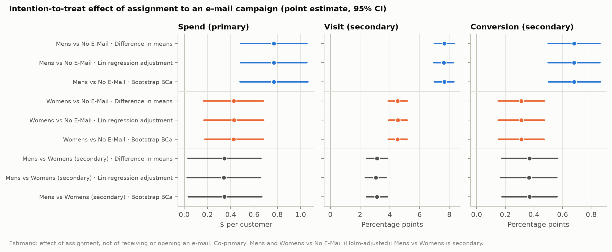

# CauseWay

A company emails its best customers and sees them spend more. Did the email cause that, or would they have bought anyway? That comparison alone can’t tell you. CauseWay starts with a randomized email experiment, then deliberately creates biased samples to test how well causal methods recover the experimental estimate.

The study uses the Hillstrom experiment, with 64,000 customers. It first estimates the effect of assigning customers to each email campaign. It then selects biased subsets using a known sampling rule and checks how closely different methods recover the experimental estimate.

Python 3.12, pandas, scikit-learn, EconML, DoubleML. Also NumPy, SciPy, statsmodels, and Matplotlib.

## Main findings

- Assignment to the Mens email increased two-week spending by about $0.77 per customer; the Womens email increased it by about $0.42.
- When the variables responsible for selection are available, weighting and AIPW—a method combining outcome and treatment models—recover the benchmark within the uncertainty from repeated sampling. This is a favorable case: their propensity model contains the true selection rule. Matching misses the benchmark in every case and linear outcome regression in nearly every case; DML misses it in isolated cases.
- When one of those variables is hidden, every feasible method remains biased, while the refutation tests and the balance of the visible variables look much as they did before.
- The effect varies detectably between customers only for visits under the Womens email. Choosing each customer's email with a model does not detectably beat sending everyone the Mens email.



A separately versioned [validation extension](docs/extension.md) applies new selection rules to a second randomized dataset (Criteo Uplift v2.1), which pools several advertising tests. Estimators given the true selection rule show no detectable bias. Nonlinear selection breaks the linear-propensity weighting and AIPW estimates for visits. Hiding a selection variable shifts every reported adjusted estimate for visits, a comparison added after the frozen run had been read. Treatment in the released file is slightly predictable from the features, and adjusting for them moves the reference effect for visits, so which estimators count as biased there depends on the reference: with the variable hidden, weighting and AIPW match the unadjusted one.

The [findings report](docs/findings.md) contains intervals, estimator comparisons, sensitivity checks, and qualifications. These findings concern this experiment and the constructed selection scenarios, not a general ranking of causal methods.

## Reproduce

To check the published results, from the repository root, with Python 3.12 installed:

```bash
make setup
make verify
make test
```

To rerun the analysis from the raw data:

```bash
make data
make analysis
make docs
```

A rerun stamps the tables with the current commit. `make verify` still checks every number and notes that they come from a rerun; `git restore reports docs` returns to the published run.

The extension needs a manual download: put the file named in [`configs/extension/criteo_gate.toml`](configs/extension/criteo_gate.toml) into `data/raw/criteo/`, then run:

```bash
make extension-data
make extension
```

The aggregate tables behind the numbers here and in the findings report are committed under [`reports/results/`](reports/results); after `make setup`, `make verify` checks each number against the committed files without rerunning anything. It does not cover the extension, whose tables are not committed.

The published results are stamped with commit `0fe84ed`, a hash from before the public history was rewritten. Its files are identical to those at `73e57c8`, so the results come from the code there.

The full analysis took about 75 minutes on eight cores in the documented run. That was an earlier timed run, not the run behind the committed tables, and it excludes the extension. Dataset files are checksum-verified before use; configurations fix the benchmark design and random seeds. Each analysis records its data checksums, code commit, and package versions, and either the benchmark specification or its plan version; the robustness plan itself is not recorded.

The comparison includes matching, weighting, regression, AIPW, and double machine learning (DML). The AIPW estimates are implemented here and checked against EconML. The DML estimates come from DoubleML and are checked against a score written here. Both checks use the first draws of each scenario. The plans for the benchmark, heterogeneity, robustness, and extension analyses were committed before the code that runs them; the experiment's plan file was committed together with its analysis, after the design record it encodes. Commit order records that sequence but cannot prove what had been inspected. The targeting policies are evaluated on data, not deployed campaigns.

CI runs linting, a dependency check, an import check, and the tests on every push to `main` and on pull requests.

## Limitations

- The effects are of being assigned an email. Receiving or opening it was not recorded.
- The Hillstrom data come from a single experiment, with a short outcome window and no cost or margin data.
- The biased samples use selection rules chosen in advance. Recovering the estimate there does not show that a method identifies effects in other observational data.
- The experimental estimate used as the benchmark has its own sampling uncertainty.

## Data and licenses

The code is released under the [MIT License](LICENSE), which does not cover either dataset. No raw data is stored or redistributed here.

- **Hillstrom e-mail experiment** ([Hillstrom, 2008](https://blog.minethatdata.com/2008/03/minethatdata-e-mail-analytics-and-data.html)): neither the publisher's post nor the file states a license or terms of use. `make data` downloads it from the publisher, or from a public mirror if that is unavailable.
- **Criteo Uplift v2.1** ([Criteo AI Lab](https://huggingface.co/datasets/criteo/criteo-uplift)), used only by the extension: CC BY-NC-SA 4.0, which requires attribution, allows non-commercial use only, and applies the same license to adaptations. It has to be downloaded separately.

[Research design](docs/design.md) · [Results](docs/findings.md) · [Setup and technical details](GUIDE.md)
