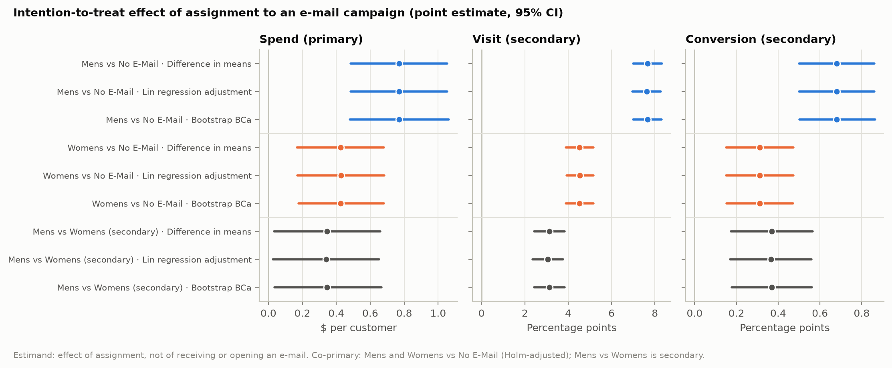

# CauseWay

A company emails its best customers and sees them spend more. Did the email cause that, or would they have bought anyway? Observational data can't separate the two, but a randomized experiment can, and it also gives a known answer to test observational methods against.

So this study starts with the Hillstrom randomized email experiment (64,000 customers) and estimates the effect of assignment to each campaign. It then removes the randomization on purpose, using RCT rejection sampling so the selection rule is known, and scores weighting, matching, regression, AIPW, and DML against the experimental benchmark.

Python 3.12, pandas, scikit-learn, EconML, DoubleML.

## Main findings

- Assignment to the Mens email increased two-week spending by about $0.77 per customer; the Womens email increased it by about $0.42.
- With observed confounders, weighting and cross-fitted AIPW recover the benchmark within Monte Carlo error.
- Hiding a confounder leaves every tested estimator biased, even when refutation checks pass.



The [findings report](docs/findings.md) contains intervals, estimator comparisons, sensitivity checks, and qualifications. These findings concern this experiment and the constructed selection scenarios, not a general ranking of causal methods.

## Reproduce

From the repository root, with Python 3.12 installed:

```bash
make setup
make data
make analysis
make docs
make test
```

The full analysis took about 75 minutes on eight cores in the documented run. Data downloads are checksum-verified; configurations fix the benchmark design and random seeds. Generated reports record the data, configuration, and environment used.

AIPW and the DML orthogonal score are written by hand and checked against EconML and DoubleML. The benchmark and analysis plans were committed before their results existed. Policy comparisons are estimates of policies that were never deployed.

[Research design](docs/design.md) · [Results](docs/findings.md) · [Setup and technical details](GUIDE.md)
