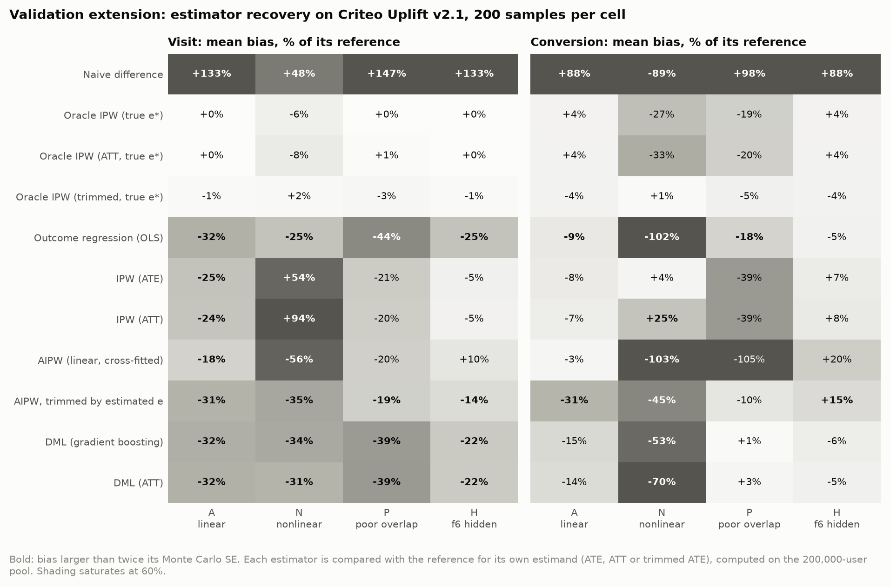

# Causeway validation extension v1: Criteo Uplift v2.1

> Copied from `reports/results/extension/extension_report.md` by `make docs`. Result tables are produced locally by `make extension`.

A separately versioned check of the Part II conclusions on a second randomized dataset, which pools several advertising tests, with linear, nonlinear, poor-overlap and hidden-confounder selection. Protocol: `configs/extension/v1.toml`, frozen before any outcome of this dataset was read; gate: `configs/extension/criteo_gate.toml`, written before its statistics were computed. Commit order records that sequence; it cannot by itself prove what was inspected. The original study and its results are unchanged.

Effects are in percentage points (pp) of the visit or conversion rate.

## 1. Data and references

Pool: 200,000 users drawn uniformly (seed 20181015) from the 13,979,592-row file (SHA-256 `2716e1bf0fd1…`), treatment share 0.851. At the gate a classifier predicted treatment from the features with out-of-fold AUC 0.508, and the largest arm difference was |SMD| 0.050: small but real imbalance.

Every reference is computed on the full pool. Conditional on the pool it is the exact target of the construction; as an estimate of a population effect it has the standard error shown.

| Outcome | Reference | Value (pp) | SE (pp) | 95% CI (pp) |
|---|---|---|---|---|
| visit | difference in means | 1.186 | 0.122 | [0.95, 1.43] |
| visit | regression-adjusted | 0.886 | 0.111 | [0.67, 1.10] |
| visit | gap (adjusted − difference) | -0.300 |  | -2.46 SE of the difference in means |
| conversion | difference in means | 0.151 | 0.028 | [0.10, 0.21] |
| conversion | regression-adjusted | 0.132 | 0.028 | [0.08, 0.19] |
| conversion | gap (adjusted − difference) | -0.019 |  | -0.69 SE of the difference in means |

ATT and trimmed references depend on the scenario's e*(x):

| Scenario | Outcome | ATT (pp) | Trimmed ATE (pp) | Trimmed share of pool |
|---|---|---|---|---|
| A | visit | 1.319 ± 0.255 | 0.451 ± 0.206 | 82% |
| A | conversion | 0.168 ± 0.061 | 0.039 ± 0.037 | 82% |
| N | visit | 1.046 ± 0.252 | 1.225 ± 0.282 | 53% |
| N | conversion | 0.144 ± 0.054 | 0.129 ± 0.064 | 53% |
| P | visit | 1.344 ± 0.258 | 0.202 ± 0.234 | 61% |
| P | conversion | 0.170 ± 0.062 | 0.027 ± 0.041 | 61% |
| H | visit | 1.319 ± 0.255 | 0.451 ± 0.206 | 82% |
| H | conversion | 0.168 ± 0.061 | 0.039 ± 0.037 | 82% |

## 2. Scenarios

| scenario | label | e* 1st–99th pct | e* > 0.99 | expected retained | largest arm SMD | hidden |
|---|---|---|---|---|---|---|
| A | Linear selection on observed features | 0.60–0.99 | 1.6% | 58,909 | 0.58 | none |
| N | Nonlinear selection on observed features | 0.06–1.00 | 3.0% | 29,711 | 0.61 | none |
| P | Poor overlap | 0.37–1.00 | 17.4% | 37,116 | 0.90 | none |
| H | Hidden confounder | 0.60–0.99 | 1.6% | 58,909 | 0.58 | f6 |

## 3. Estimator recovery



Mean bias over 200 draws as a share of each estimator's own reference; `*` marks a bias larger than twice its Monte Carlo SE. Each cell is a separate test at about the 5% level, so isolated flags are weak evidence. Coverage is read against the oracle's, since every draw comes from the same pool.

**Visit**

| Estimator | Reference | A bias | A cover | N bias | N cover | P bias | P cover | H bias | H cover | max failure rate |
|---|---|---|---|---|---|---|---|---|---|---|
| naive_difference | ATE | +133.0% * | 0% | +48.4% * | 51% | +147.1% * | 0% | +133.0% * | 0% | 0.0% |
| oracle_ipw | ATE | +0.2% | 93% | -5.8% | 86% | +0.2% | 70% | +0.2% | 93% | 0.0% |
| oracle_ipw_att | ATT | +0.2% | 92% | -7.8% | 86% | +0.6% | 70% | +0.2% | 92% | 0.0% |
| oracle_trimmed | ATE_trimmed | -1.2% | 98% | +1.8% | 98% | -2.8% | 95% | -1.2% | 98% | 0.0% |
| outcome_regression | ATE | -32.0% * | 80% | -25.2% * | 96% | -43.6% * | 86% | -24.9% * | 86% | 0.0% |
| ipw_ate | ATE | -24.9% * | 96% | +54.3% * | 64% | -21.3% | 72% | -5.0% | 95% | 0.0% |
| ipw_att | ATT | -24.4% * | 95% | +93.7% * | 48% | -20.2% | 72% | -4.5% | 92% | 0.0% |
| aipw | ATE | -18.5% * | 92% | -55.6% * | 76% | -19.7% | 96% | +10.1% | 94% | 0.0% |
| aipw_trimmed | ATE_trimmed | -31.4% * | 91% | -34.9% * | 82% | -19.3% * | 96% | -14.2% * | 97% | 0.0% |
| dml_irm | ATE | -32.5% * | 90% | -34.3% * | 88% | -38.6% * | 92% | -22.2% * | 92% | 0.0% |
| dml_irm_att | ATT | -32.0% * | 92% | -31.1% * | 90% | -38.7% * | 92% | -21.9% * | 92% | 0.0% |

**Conversion**

| Estimator | Reference | A bias | A cover | N bias | N cover | P bias | P cover | H bias | H cover | max failure rate |
|---|---|---|---|---|---|---|---|---|---|---|
| naive_difference | ATE | +88.4% * | 8% | -88.6% * | 81% | +97.7% * | 12% | +88.4% * | 8% | 0.0% |
| oracle_ipw | ATE | +4.1% | 67% | -26.6% | 82% | -19.3% | 33% | +4.1% | 67% | 0.0% |
| oracle_ipw_att | ATT | +4.4% | 66% | -33.1% | 60% | -19.6% | 28% | +4.4% | 66% | 0.0% |
| oracle_trimmed | ATE_trimmed | -4.3% | 96% | +1.3% | 98% | -5.0% | 94% | -4.3% | 96% | 0.0% |
| outcome_regression | ATE | -8.6% * | 89% | -101.6% * | 91% | -17.9% * | 86% | -4.8% | 92% | 0.0% |
| ipw_ate | ATE | -7.6% | 68% | +3.7% | 98% | -38.9% | 28% | +7.3% | 66% | 0.0% |
| ipw_att | ATT | -6.6% | 66% | +24.8% * | 80% | -39.1% | 24% | +8.4% | 65% | 0.0% |
| aipw | ATE | -2.9% | 80% | -103.5% * | 55% | -105.4% | 64% | +20.3% | 84% | 0.0% |
| aipw_trimmed | ATE_trimmed | -30.9% * | 98% | -44.6% * | 97% | -10.3% | 94% | +14.6% * | 94% | 0.0% |
| dml_irm | ATE | -15.4% | 82% | -53.3% * | 91% | +1.3% | 69% | -6.3% | 80% | 1.0% |
| dml_irm_att | ATT | -14.2% | 81% | -69.5% * | 93% | +3.2% | 68% | -4.9% | 80% | 1.0% |

Feasible estimators whose bias is within Monte Carlo error, by scenario:

- **A** (linear selection on observed features): visit: none; conversion: ipw_ate, ipw_att, aipw, dml_irm, dml_irm_att.
- **N** (nonlinear selection on observed features): visit: none; conversion: ipw_ate.
- **P** (poor overlap): visit: ipw_ate, ipw_att, aipw; conversion: ipw_ate, ipw_att, aipw, aipw_trimmed, dml_irm, dml_irm_att.
- **H** (hidden confounder): visit: ipw_ate, ipw_att, aipw; conversion: outcome_regression, ipw_ate, ipw_att, aipw, dml_irm, dml_irm_att.

## 4. Against the regression-adjusted reference

ATE estimators adjust for the features, so if the pool's slight imbalance mattered they would track the adjusted reference rather than the difference in means. Bias against the adjusted reference:

| Outcome | Estimator | A | N | P | H |
|---|---|---|---|---|---|
| visit | oracle_ipw | +34.1% * | +26.1% * | +34.2% | +34.1% * |
| visit | outcome_regression | -8.9% * | +0.2% | -24.5% * | +0.6% |
| visit | ipw_ate | +0.5% | +106.7% * | +5.3% | +27.2% * |
| visit | aipw | +9.1% | -40.5% * | +7.6% | +47.4% * |
| visit | dml_irm | -9.6% * | -12.0% | -17.8% | +4.2% |
| conversion | oracle_ipw | +19.3% * | -15.8% | -7.5% | +19.3% * |
| conversion | outcome_regression | +4.8% | -101.9% * | -5.8% | +9.2% * |
| conversion | ipw_ate | +5.9% | +18.9% * | -30.0% | +23.0% * |
| conversion | aipw | +11.4% | -104.0% * | -106.2% | +38.0% * |
| conversion | dml_irm | -3.0% | -46.5% * | +16.1% | +7.4% |

## 5. Balance, overlap and fit diagnostics

Means over draws.

| Scenario | Retained users | Largest |SMD| before / after IPW | Hidden f6 |SMD| before / after | Control ESS share | Largest control weight / mean | ê outside [0.01, 0.99] | Trimmed-set agreement (ê vs e*) | DoubleML fits / failed / nu2 fallbacks |
|---|---|---|---|---|---|---|---|---|
| A | 58,918 | 0.69 / 0.07 | — | 40% | 42 | 2.2% | 98.8% | 800 / 2 / 14 |
| N | 29,714 | 0.62 / 0.15 | — | 30% | 23 | 1.2% | 83.3% | 800 / 0 / 12 |
| P | 37,128 | 1.04 / 0.27 | — | 8% | 211 | 17.8% | 99.1% | 800 / 4 / 74 |
| H | 58,918 | 0.52 / 0.11 | 0.69 / 0.26 | 44% | 58 | 1.2% | 90.9% | 800 / 2 / 20 |

DoubleML's nonpositive-nu2 fallbacks are recorded, not suppressed. They concern only DoubleML's own sensitivity analysis, which is not used; the estimates and SEs come from the score.

Reasons DoubleML refused a fit: For the binary variable _y, predictions obtained with the ml_g learner HistGradientBoostin.

## 6. Implementation cross-checks

First 10 draws of each scenario, same models and folds.

| check | scenario | comparisons | max_abs_difference |
|---|---|---|---|
| aipw_econml vs aipw | A | 20 | 1.4e-17 |
| aipw_econml vs aipw | H | 20 | 6.9e-18 |
| aipw_econml vs aipw | N | 20 | 6.9e-18 |
| aipw_econml vs aipw | P | 20 | 2.3e-17 |
| dml_hand vs dml_irm | A | 20 | 0.0e+00 |
| dml_hand vs dml_irm | H | 20 | 0.0e+00 |
| dml_hand vs dml_irm | N | 20 | 0.0e+00 |
| dml_hand vs dml_irm | P | 20 | 0.0e+00 |

## 7. Post-hoc analyses (not in the frozen protocol)

Added after the frozen run had been read, because the two predeclared ATE references disagree. They use only saved outputs and the pool.

**Full-pool effect with and without adjustment.** If treatment were unrelated to the features in the pool, every row would agree up to noise much smaller than the difference in means' own SE.

| Outcome | Method | Effect (pp) | SE (pp) | Gap from difference in means |
|---|---|---|---|---|
| visit | difference in means | 1.186 | 0.122 | — |
| visit | Lin regression adjustment | 0.886 | 0.111 | -0.300 pp (-2.46 SE) |
| visit | cross-fitted AIPW, linear | 0.887 | 0.111 | -0.299 pp (-2.45 SE) |
| visit | DML, gradient boosting | 0.827 | 0.112 | -0.359 pp (-2.94 SE) |
| conversion | difference in means | 0.151 | 0.028 | — |
| conversion | Lin regression adjustment | 0.132 | 0.028 | -0.019 pp (-0.69 SE) |
| conversion | cross-fitted AIPW, linear | 0.134 | 0.028 | -0.016 pp (-0.59 SE) |
| conversion | DML, gradient boosting | 0.110 | 0.031 | -0.041 pp (-1.46 SE) |

A cross-fitted gradient-boosting propensity on the full pool ranges from 0.53 to 0.97.

**Hiding f6, paired by draw.** Scenario H keeps exactly the users of scenario A and only hides f6, so the per-draw difference H − A measures the effect of the hidden feature without any reference.

| Outcome | Estimator | Mean shift H − A (pp) | As % of the difference in means | Beyond 2 MC SE |
|---|---|---|---|---|
| conversion | aipw | +0.035 ± 0.018 | +23.2% | yes |
| visit | aipw | +0.339 ± 0.090 | +28.6% | yes |
| conversion | dml_irm | +0.014 ± 0.017 | +9.1% | no |
| visit | dml_irm | +0.122 ± 0.053 | +10.3% | yes |
| conversion | dml_irm_att | +0.016 ± 0.021 | +10.4% | no |
| visit | dml_irm_att | +0.134 ± 0.063 | +11.3% | yes |
| conversion | ipw_ate | +0.022 ± 0.011 | +14.9% | yes |
| visit | ipw_ate | +0.236 ± 0.033 | +19.9% | yes |
| conversion | ipw_att | +0.025 ± 0.013 | +16.8% | yes |
| visit | ipw_att | +0.262 ± 0.039 | +22.0% | yes |
| conversion | outcome_regression | +0.006 ± 0.002 | +3.8% | yes |
| visit | outcome_regression | +0.085 ± 0.009 | +7.1% | yes |

## 8. Reading the results

- **The construction works.** 0 of 24 oracle cells show bias beyond twice their Monte Carlo SE.
- **The difference in means is not a clean reference for adjusted estimators on visit.** Adjusting for the features moves the full-pool visit effect by -0.300 pp (-25%; -2.5 SE), and the nonparametric DML adjustment agrees (0.827 pp). Treatment in the released file is slightly predictable from features that predict visits. The gate's tolerances, set before any outcome was read, did not anticipate that so small an imbalance could matter this much. In scenario A the adjusted estimators' visit bias against the difference in means ranges from -32% to -18%, the same order as this gap.
- **Scenario A, against the adjusted reference:** ipw_ate, aipw recover it within Monte Carlo error on visit.
- **Nonlinear selection (N):** linear-propensity IPW is biased by +54% and linear AIPW by -56% against the difference in means (+107% and -40% against the adjusted reference). DML with boosted nuisances is closer: -12% against the adjusted reference.
- **Hiding f6 (H):** the paired shift on visit is +0.236 pp for IPW, +0.339 pp for AIPW, +0.085 pp for outcome regression and +0.122 pp for DML. Hiding a selection feature moves each of these estimates; the size depends on the estimator and on how much of f6 the remaining features carry. This is a shift between two analyses of the same users, not by itself a bias against either reference.
- **Poor overlap (P):** the oracle's own visit interval covers its reference in only 70% of draws, so interval coverage is not informative there; DoubleML's nu2 fallbacks are also concentrated in this scenario.
- **Conversion** is rare (about 0.3%), so even the oracle's Monte Carlo error is large; conversion results support few conclusions either way.

## 9. Expectations written before outcomes were read

- **oracle**: unbiased in every cell
- **A**: IPW, AIPW and DML unbiased; outcome regression may be biased if the linear model is misspecified
- **N**: linear-propensity IPW and AIPW may be biased (misspecified propensity; AIPW protected only if its outcome model is right); DML expected to do best
- **P**: unbiased estimators remain so in expectation but with larger variance and worse coverage; weights extreme
- **H**: bias for adjusted estimators only to the extent that f6 predicts visits given the other features, which is unknown beforehand
- **generalization**: success under a known constructed selection rule does not establish identification in other observational data

## 10. What this does and does not show

- It tests estimator behaviour under selection rules that are known by construction. Success here does not establish identification in other observational data, where the selection rule is unknown.
- Scenario H can show bias only to the extent that the hidden feature predicts outcomes given the others; that relation was unknown when the protocol was frozen.
- The original study's hidden-confounder failures and negative targeting result stand as reported; this extension neither replaces nor reruns them.

## 11. Provenance and commands

- Code: `8a24350`.
- Protocol SHA-256 `cb8bbf12bdd1…`; gate SHA-256 `e1ef3878c435…`.
- Pool parquet SHA-256 `d88b4d1bbb54…`.
- Post-hoc analyses (Sections 7 and 8): code `cdaaba9`.
- Python 3.12.15; numpy 2.4.6, pandas 3.0.6, pyarrow 26.0.0, scipy 1.15.3, statsmodels 0.15.0, scikit-learn 1.9.1, econml 0.17.0, doubleml 0.11.4.

```bash
make extension-data   # verify the downloaded file and build the pool
make extension        # run the 800 constructed samples and write this report
```
